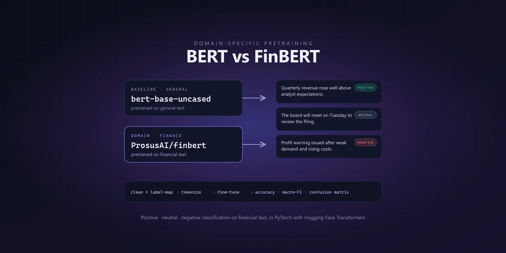
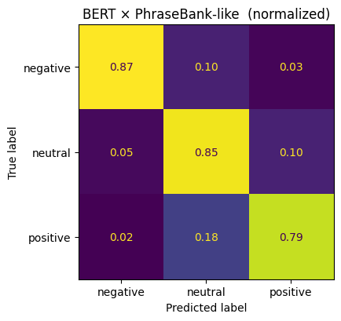
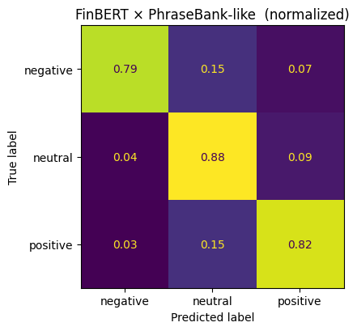
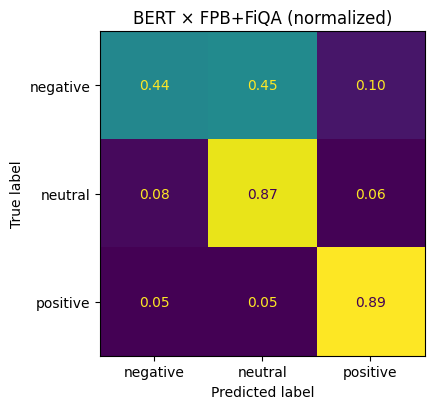
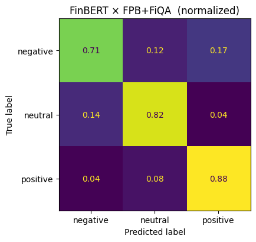
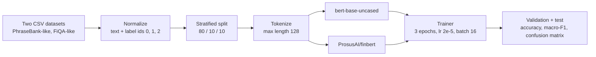

<div align="center">
  

  <p><code>Fine-tuning BERT and FinBERT on two financial sentiment datasets to measure the effect of domain-specific pretraining.</code></p>

  <a href="https://github.com/Saji-d/financial-sentiment-analysis-bert"></a>
  <a href="https://colab.research.google.com/github/Saji-d/financial-sentiment-analysis-bert/blob/main/financial_sentiment_bert_vs_finbert.ipynb"></a>
  
  <br>
  
  
  
  
  

  <p>
    <a href="#-overview">Overview</a> ·
    <a href="#-highlights">Highlights</a> ·
    <a href="#-preview">Preview</a> ·
    <a href="#-pipeline">Pipeline</a> ·
    <a href="#-results">Results</a> ·
    <a href="#-tech-stack">Tech Stack</a> ·
    <a href="#-getting-started">Getting Started</a> ·
    <a href="#-project-structure">Structure</a> ·
    <a href="#-author">Author</a>
  </p>
</div>


## ◈ Overview

Investor opinion in news and reports moves markets, so reading its tone automatically is a classic NLP task. This coursework project asks whether a model pretrained on financial text (FinBERT) beats a general model (BERT) at classifying financial statements as negative, neutral or positive when both are fine-tuned the same way.

Both models are fine-tuned with identical settings on two Kaggle datasets that resemble Financial PhraseBank and FiQA, then compared on accuracy and macro-F1 with confusion matrices. A short report in `report/` is written up in IEEE style. The notebook also contains two earlier lab tasks (minimum edit distance and an n-gram language model on the Brown corpus), which are unrelated to the BERT comparison.

> [!NOTE]
> This is an academic comparison, not a production sentiment service. The datasets are not bundled in the repository.


## ◈ Highlights

<table>
  <tr>
    <td width="33%"><b>Fair comparison</b><br>Same seed, epochs, learning rate, batch size and max length for both models.</td>
    <td width="33%"><b>Two datasets</b><br>A PhraseBank-like set (4,846 sentences) and a FiQA-like set (5,842 sentences).</td>
    <td width="33%"><b>Stratified splits</b><br>80% train, 10% validation and 10% test, with the best checkpoint chosen on validation accuracy.</td>
  </tr>
  <tr>
    <td><b>Three classes</b><br>Negative, neutral and positive labels mapped consistently across datasets.</td>
    <td><b>Hugging Face Trainer</b><br>Fine-tuning of <code>bert-base-uncased</code> and <code>ProsusAI/finbert</code> with dynamic padding.</td>
    <td><b>Error analysis</b><br>Raw and row-normalized confusion matrices for all four runs.</td>
  </tr>
</table>


## ◈ Preview

<div align="center">
  
</div>

<br>

<table>
  <tr>
    <td align="center"><br><sub>BERT on PhraseBank-like</sub></td>
    <td align="center"><br><sub>FinBERT on PhraseBank-like</sub></td>
  </tr>
  <tr>
    <td align="center"><br><sub>BERT on FiQA-like</sub></td>
    <td align="center"><br><sub>FinBERT on FiQA-like</sub></td>
  </tr>
</table>


## ◈ Pipeline




## ◈ Results

Test-set scores printed by the notebook (random seed 42, 3 epochs each):

| Dataset | Model | Test accuracy | Test macro-F1 |
|---|---|---:|---:|
| PhraseBank-like (485 test sentences) | BERT | 83.71% | 0.8223 |
| PhraseBank-like | **FinBERT** | **84.95%** | 0.8229 |
| FiQA-like (585 test sentences) | BERT | 81.20% | 0.7377 |
| FiQA-like | **FinBERT** | **82.39%** | **0.7830** |

Validation accuracy tells the same story: FinBERT 87.42% against BERT 85.77% on PhraseBank-like and 79.45% against 78.25% on FiQA-like.

**Reading the numbers.** FinBERT is ahead on accuracy in both datasets and on macro-F1 in both, but the margin is small on PhraseBank-like (macro-F1 differs by 0.0006) and larger on FiQA-like, where it handles the minority negative class better. These are single runs with one seed, so the gaps should be read as indicative rather than statistically established.


## ◈ Tech Stack

| Layer | Technologies | Purpose |
|---|---|---|
| Models | Hugging Face Transformers, PyTorch | BERT and FinBERT fine-tuning with the Trainer API |
| Data | datasets, pandas, NumPy | Normalization, label mapping and splits |
| Evaluation | scikit-learn, Matplotlib | Accuracy, macro-F1 and confusion matrices |
| Environment | Google Colab (GPU), Jupyter | Run the notebook end to end |


## ◈ Getting Started

**Prerequisites:** a GPU runtime is strongly recommended. The simplest route is Google Colab through the badge above.

```bash
git clone https://github.com/Saji-d/financial-sentiment-analysis-bert.git
cd financial-sentiment-analysis-bert
pip install "transformers>=4.41.0" "datasets>=2.20.0" "accelerate>=0.34.0" scikit-learn torch pandas matplotlib nltk jupyter
jupyter notebook financial_sentiment_bert_vs_finbert.ipynb
```

The notebook expects two CSV files next to it, which are not included. Their names and columns come from the notebook code:

| File | Columns |
|---|---|
| `financial_news_sentiment_dataset.csv` | `news`, `label` |
| `financial_finance_qa_sentiment_dataset.csv` | `Sentence`, `Sentiment` |

Labels must be `negative`, `neutral` or `positive`.


## ◈ Project Structure

One notebook holds all three tasks, the IEEE-style report is in `report/` and the figures are in `docs/`.

```text
.
├── financial_sentiment_bert_vs_finbert.ipynb   # tasks 1 and 2 (lab exercises) and task 3 (BERT vs FinBERT)
├── report/
│   └── financial_sentiment_bert_vs_finbert.pdf # IEEE-style write-up
├── docs/                                       # preview cover and confusion matrices
├── assets/                                     # banner and divider
└── README.md
```


## ◈ Author

**Sajidur Rahman Sajid**: Full-Stack Developer and AI engineer from Dhaka.<br>
BSc in CSE at American International University-Bangladesh (AIUB).

Report co-authors: Badhan Ghosh and Sidratul Muntaha (AIUB, Natural Language Processing course).

<p>
  <a href="https://www.sajidur.me"></a>
  <a href="https://www.linkedin.com/in/sajidur-rahman-sajid/"></a>
  <a href="https://github.com/Saji-d"></a>
  <a href="mailto:sajidsajidurrahman99@gmail.com"></a>
</p>

<sub>Part of a larger NLP repository: <a href="https://github.com/Saji-d/natural-language-processing">natural-language-processing</a>.</sub>
